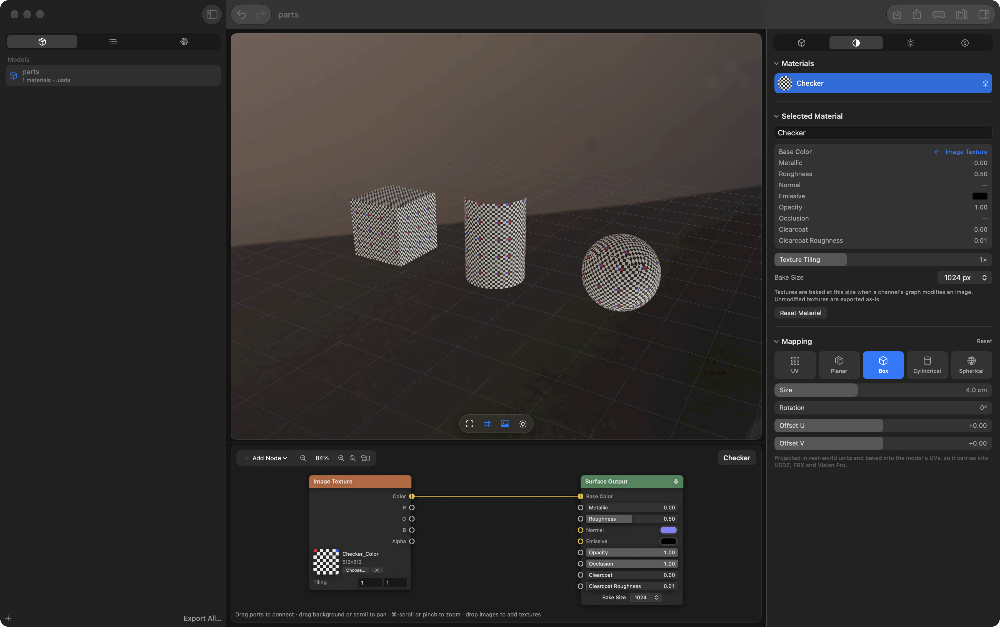
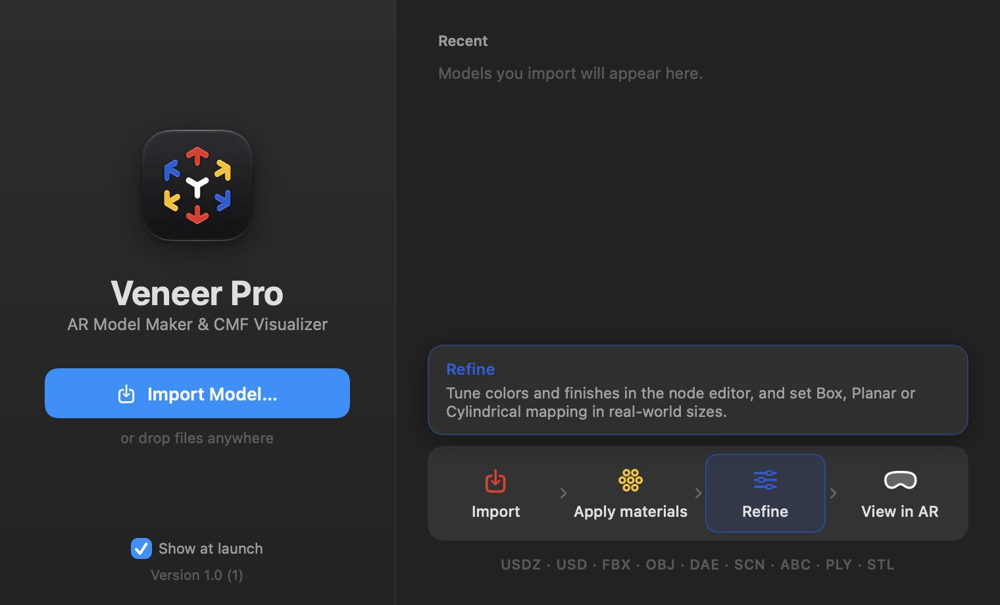

# Veneer Pro

**An AR model maker and CMF (color, material, finish) visualizer for macOS.** Import 3D models, dress them in node-based materials (built-in, or from your own Visune and KeyShot libraries), set KeyShot-style texture mapping, preview them live on Apple Vision Pro or on an iPhone/iPad, and export USDZ or FBX.

It began as a from-scratch take on Apple's Reality Converter. The difference is that **materials are edited as node graphs** instead of fixed channel slots.



## Download

1. Download **Veneer-Pro-macOS.zip** from the [latest release](../../releases/latest) and unzip it.
2. Move **Veneer Pro.app** to your Applications folder.
3. The first time, **right-click the app → Open → Open**. The app isn't notarized by Apple, so macOS asks once. If macOS still refuses, go to System Settings → Privacy & Security and click **Open Anyway**.

**Requirements**
- macOS 27 or later on an Apple Silicon Mac.
- Optional: [Reality Converter](https://developer.apple.com/augmented-reality/tools/) (free from Apple) for **FBX import**. Veneer Pro uses its FBX converter. FBX *export* works without it.
- Optional: an Apple Vision Pro for the live spatial preview, or any iPhone/iPad on the same Wi-Fi for **Share to iPhone or iPad**.

No account, setup or material library is needed: the built-in **Veneer Essentials** library works out of the box.

## Build from source

```sh
./build-app.sh                      # → build/Veneer Pro.app
open "build/Veneer Pro.app"
```

Requires Xcode with the macOS 27 SDK. You can also open `Package.swift` in Xcode.

Headless conversion:

```sh
"build/Veneer Pro.app/Contents/MacOS/VeneerPro" --convert model.obj model.usdz
# apply one library material to every material, with maps capped at 2K
"build/Veneer Pro.app/Contents/MacOS/VeneerPro" --convert model.obj model.usdz \
    --material "$HOME/Documents/Visune Asset Library/Materials/Wood/Oak Wood 001" --texture-size 2048
# a KeyShot material works too; add --mapping box|planar|cylindrical|spherical [--mapping-size 0.05] [--mapping-axis Y] to project it
"build/Veneer Pro.app/Contents/MacOS/VeneerPro" --convert model.obj model.usdz \
    --material "/Library/Application Support/KeyShot Studio/Materials/Wood/Traditional/Walnut.mtl"
# or one of the built-in Veneer Essentials materials, by name
"build/Veneer Pro.app/Contents/MacOS/VeneerPro" --convert model.obj model.usdz --material "Walnut" --mapping box
# list what the library scanner detects
"build/Veneer Pro.app/Contents/MacOS/VeneerPro" --scan-library "/Library/Application Support/KeyShot Studio/Materials"
```

## Features




- **Import**: USDZ / USD / USDA / USDC / **FBX** / OBJ / DAE / SCN / ABC / PLY / STL. Drag files or folders onto the window. Textures packed inside a USDZ are kept under their original file names. Copies of the same material that SceneKit splits per mesh (common in Reality Composer files) are merged into one editable material. FBX is converted with the Autodesk FBX SDK–based converter inside Apple's free **Reality Converter**, which must be installed. It runs in a helper process, so a bad file can't crash the app. It keeps units, hierarchy, materials and skeletons. FBX files often point at textures on the original author's machine; when those are missing, same-named textures near the FBX (e.g. a sibling `Textures` folder) are used instead. glTF isn't supported.
- **View on Apple Vision Pro (live)**: the toolbar's Vision Pro button opens the selected model in Quick Look on Apple Vision Pro using macOS 27's Spatial Preview framework, with no visionOS app or file sharing needed.
  - **Connecting**: with the headset connected via Mac Virtual Display it opens straight away; otherwise Apple's device picker appears.
  - **Live updates**: the preview stays live while you work. Material edits, library materials, renames, visibility, transforms and deletions update in the headset within about half a second.
  - **How it works**: the scene is one ordinary USD layer in a USDKit stage, shared once with `USDPreviewSession` and never reopened; every edit changes that same scene. Value edits (colors, roughness, metallic, texture files…) become individual `setValue` calls. Applying a different library material updates the existing material in place: its USD name stays fixed for the session, so the model's parts are never rebound. Only materials whose graph changed are re-evaluated, live textures are baked at up to 1K and named by content, and unchanged bakes are reused. Undo/redo gestures in the headset drive the app's undo history, and the headset's annotation, per-object move and export tools are enabled. Each update is logged to `~/Library/Logs/Veneer Pro/VisionPro.log`.
  - **Unoptimized sharing**: the stage is shared with Spatial Preview's optimization off (`.unmodified`), because an optimized scene can be rebuilt on the headset and then ignores edits.
  - **Fallback**: if the scene is too heavy to share unoptimized, the app sends a USDZ and re-sends it after every change.
- **Welcome window**: a quiet splash at launch, like a CAD or photo-editor start screen.
  - **Left:** the app icon and name, Import Model… (⌘O) and a "Show at launch" checkbox.
  - **Right:** recent models (click to reopen), an Import → Apply materials → Refine → View in AR strip (hover a step for details, click to keep it open), and the supported formats on one line.
  - **Drops:** files dropped anywhere on the window are imported.
  - **Reopening:** Help → Welcome to Veneer Pro (⇧⌘1). It's skipped when the app is launched by opening a file.
- **Interface**: a dark, Pixelmator/Photomator-style workspace.
  - **Canvas**: the viewport and node editor sit as rounded panes on a recessed canvas.
  - **Viewer bar**: a floating bar at the bottom of the viewport holds Frame, Grid, Background, Lighting, Play, and Show All when an object is isolated.
  - **Panels**: the sidebar and inspector use icon tabs, and inspector sections collapse (their state is remembered).
  - **Bar sliders**: sliders carry their label and value inside the bar. Drag anywhere, hold ⌥ for fine control, double-click to reset.
  - **Status**: messages appear in a small label at the top-left of the viewport.
- **Mapping types** (Materials inspector → Mapping): UV, Planar, Box, Cylindrical or Spherical projection per material, like KeyShot.
  - **Controls**: axis, real-world tile size (cm), rotation and offset.
  - **Projection**: projections are measured in real-world units, so a tile has the same physical size on every part. Cylindrical and spherical wrap around each part's own center.
  - **Baking**: the projection is baked into the meshes' UVs, so it shows in the viewer, on Apple Vision Pro, and in USDZ and FBX exports.
  - **Original UVs**: switching back to UV restores them exactly.
  - **Undo**: mapping changes are undoable.
  - **Command line**: `--mapping box --mapping-size 0.05 --mapping-axis Y` (size in meters).
- **Share to iPhone or iPad** (toolbar QR button or File → Share to iPhone or iPad…, ⇧⌘S): no app, App Store or upload needed.
  - **How it works:** Veneer Pro serves the selected model from your Mac over your Wi-Fi and shows a QR code. Scan it with the iPhone or iPad Camera, then tap **View in AR** to open the model in AR Quick Look.
  - **Updates:** the model is re-exported about a second after each edit, and the phone's page shows "Load the latest version" when there's a newer one. (AR Quick Look can't refresh a model that's already open.)
  - **Sending the file:** AirDrop, Messages and Mail buttons send the current USDZ directly.
  - **Privacy:** links carry a random code and stop working when you click Stop Sharing. Nothing leaves your local network, but anyone on the same Wi-Fi with the link can view the model while sharing is on.
  - **Firewall:** if the macOS firewall is on, allow Veneer Pro to accept incoming connections the first time.
- **Undo / Redo**: toolbar buttons and ⌘Z / ⇧⌘Z (the Edit menu names the step, e.g. "Undo Apply “Walnut”"). Covers material graph edits (slider drags and node moves become one step), applying or resetting materials, renames, and object visibility, deletion, transforms and material separation. While you're typing in a text field, ⌘Z undoes the typing.
- **Objects**: the sidebar's **Scene** tab shows the model's object tree, with filtering, an eye toggle to hide (hidden objects export as invisible) and a target button to **isolate** an object (view only, not exported). Clicking a part in the viewport selects its object, outlined in the accent color. The inspector's **Object** tab edits the name, visibility, position/rotation/scale (drag an axis label to scrub), and lists the object's materials. **Give This Object Its Own Materials** copies shared materials so one part can differ from the rest; with an object selected, the material library's Apply button does this automatically and applies to that object only. Frame focuses the selected object.
- **Viewport**: SceneKit preview with image-based lighting from real HDR environments. Click a surface to select its material.
  - **Environment tab**: Rotation, Brightness and Exposure sliders, background and grid toggles. Your choice is remembered between launches.
  - **My HDRIs**: **Add HDRI…**, or drop `.hdr`, `.exr`, KeyShot `.hdz`/`.klf` files or folders onto the Environment tab.
  - **KeyShot**: environments are found automatically in `/Library/Application Support/KeyShot Studio/Environments`, grouped like KeyShot. `.hdr`/`.exr` load directly, `.hdz` (KeyShot's wrapper around a Radiance RGBE image) is converted on the fly, and `.klf` studio and Sun & Sky setups are re-created in HDR from their light pins. Large HDRIs are downsampled to 2K float, keeping highlight values above 1.0 for reflections.
  - **Built-in**: five procedural HDR studios (Studio, Sunset, Overcast, Night, Warehouse).
- **Node material editor**: each material is a graph that ends in a **Surface Output** node (Base Color, Metallic, Roughness, Normal, Emissive, Opacity, Occlusion, Clearcoat, Clearcoat Roughness).
  - Nodes: Color, Value, Image Texture (with tiling and R/G/B/A outputs), Checker, Gradient, Noise, Mix (Mix/Multiply/Screen/Overlay), Math, Invert, Hue/Saturation, Brightness/Contrast, Separate RGBA, Combine RGB, Normal Strength.
  - Drag from an output port to an input port to connect them. Drag a connected input away to disconnect it. Drop image files onto the editor to create texture nodes. Each node shows a live preview.
- **Veneer Essentials**: a built-in library that always appears first, so the app works with no folders linked. It has 37 materials in 10 categories:
  - Metal: chrome, brushed aluminum, stainless, anodized, gold, copper.
  - Plastic: glossy and matte ABS, soft-touch, translucent.
  - Paint: car paints with clearcoat, satin, matte.
  - Glass: clear, frosted, smoked.
  - Rubber and silicone.
  - Wood: oak, walnut, lacquered maple.
  - Fabric and leather.
  - Ceramic and stone: ceramic, terracotta, concrete, marble.
  - Light: LEDs.

  Plain finishes are single values (a few KB in USDZ). Wood, fabric, stone and brushed metal are procedural node graphs that tile seamlessly and bake to textures on export, and they work with any mapping type. Apply them by name on the command line, e.g. `--material "Walnut"` or `--material "Metal/Gold"`.
- **Material libraries (KeyShot-style)**: the sidebar's **Materials** tab browses one or more material folders. Switch between them from the library name menu, or add more with **Add Library Folder…**. Your own Visune (`~/Documents/Visune Asset Library/Materials`) and KeyShot (`/Library/Application Support/KeyShot Studio/Materials`) are found automatically. Each library has category and subcategory chips, search, and preview thumbnails.
  - **Applying**: double-click a material to apply it to the selected material, or drag it onto a part in the viewport or onto the node editor. The node graph is filled in automatically.
  - **Texture-map folders** (Visune, ambientCG, Poliigon…): maps are matched by filename suffix (`_Diffuse`/`_Albedo`/`_Color`, `_Roughness`, `_Glossiness`, `_Metallic`, `_NormalGL`/`_NormalDX`, `_AO`, `_Opacity`, `_Emissive`). Glossiness goes through an **Invert** node; DirectX normals go through **Separate → Invert G → Combine**.
  - **KeyShot `.mtl` files**: the shader graph is read and about 30 KeyShot surface types are mapped to PBR values. Texture chains become real nodes: `texture2` → Image Texture, `lux_color_adjust` → Hue/Saturation, `convert_rgba_to_float` → **Map Range**. Bump maps in normal-map mode become the Normal input. Roughness is converted the same way KeyShot's own USD export does (√roughness), and KeyShot's measured metal presets (gold, copper, chrome…) become their physical reflectance colors. Thumbnails come from the preview KeyShot embeds in each file. KeyShot 14's binary `.mtl` format is supported through its texture maps.
  - **Approximations**: procedural patterns (wood, noise, brushed) are flattened to their average color. Colors KeyShot doesn't expose (encrypted Axalta/DuPont paints, coated or anodized metals) are sampled from KeyShot's own preview render. Glass is built from its transmission tint, since USDZ has no refraction.
  - **Max Texture**: downsamples large maps (default 2K). 16-bit maps are converted to 8-bit, and large opaque PNGs are stored as high-quality JPEG, to keep USDZ files AR-friendly.
  - **Texture Tiling**: a control in the material inspector that repeats every texture in the material.
- **Metadata**: copyright, meters per unit, and up axis are read from USD sources and written back on export.
- **Export**: a custom USD writer emits a `UsdPreviewSurface` network per material, packaged as a 64-byte-aligned USDZ. With the system tools present, the root layer is converted to binary with `/usr/bin/usdcat` and validated with `usdchecker --arkit`; the Issues section shows the results.
- **FBX export**: choose **Format: FBX** in the Export dialog (or name the file `.fbx` on the command line). The app writes binary FBX 7.4 with:
  - the object hierarchy and transforms, meshes with normals and UVs, and per-face materials;
  - units and up axis;
  - textures embedded in the file (original files when unmodified, otherwise baked);
  - zlib-compressed geometry, usually smaller than the USDZ.

  Materials use FBX's Phong properties with Blender's exporter conventions: base color → DiffuseColor, metallic → ReflectionFactor, roughness → ShininessExponent, emissive → EmissiveColor, normal → NormalMap. When Reality Converter is installed, each export is read back with Autodesk's FBX SDK as a check; failures appear under Issues.

## How graphs become USD

`UsdPreviewSurface` can't do math, so the graph is evaluated on the CPU for each surface input:

- **Constant**: the input is written as a plain value. sRGB colors are converted to linear.
- **Unmodified texture**: the original file is copied into the package byte-for-byte and the needed channel (`rgb`/`r`/`g`/`b`/`a`) is connected.
- **Anything else**: the result is baked to a PNG at the material's Bake Size (512 to 4096 px).

## Limitations

- Animation, skinning, and blend shapes aren't exported (USDZ or FBX); the bind pose is. FBX has no standard for clearcoat or occlusion, so those aren't written to FBX, and importers differ in how much of ReflectionFactor/ShininessExponent they read (Apple's own FBX reader ignores roughness).
- KeyShot `.klf` studios are re-created from their light pins. Light positions, sizes and edges match KeyShot's previews, but floors tend to come out somewhat darker, and Sun & Sky uses a simplified sky model.
- Only the first UV set is exported. Vertex colors, lines, and points are dropped.
- Library: Height/displacement, Specular and anisotropy maps are skipped because USDZ's surface model has no input for them, and KeyShot bump maps in height mode are skipped for the same reason. KeyShot procedural patterns, labels/decals, flakes, thin-film and cloth weave effects become flat colors, and KeyShot's real-world texture scale isn't carried over (use Texture Tiling instead).

## Disclaimer

Veneer Pro is an independent project and isn't affiliated with or endorsed by Apple, Visune or Luxion (KeyShot). It doesn't include any Visune or KeyShot content. It reads libraries you already have installed, and the built-in Veneer Essentials materials are original. Apple Vision Pro, AR Quick Look, Reality Converter and USDZ are trademarks or technologies of Apple Inc.

## License

[MIT](LICENSE) © 2026 Kevin Park
